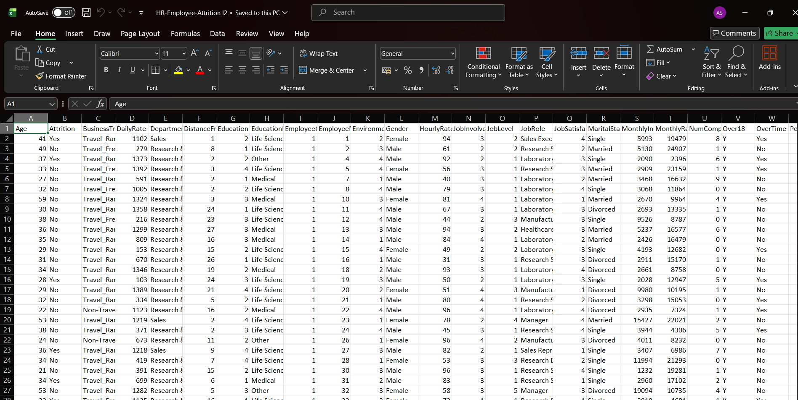
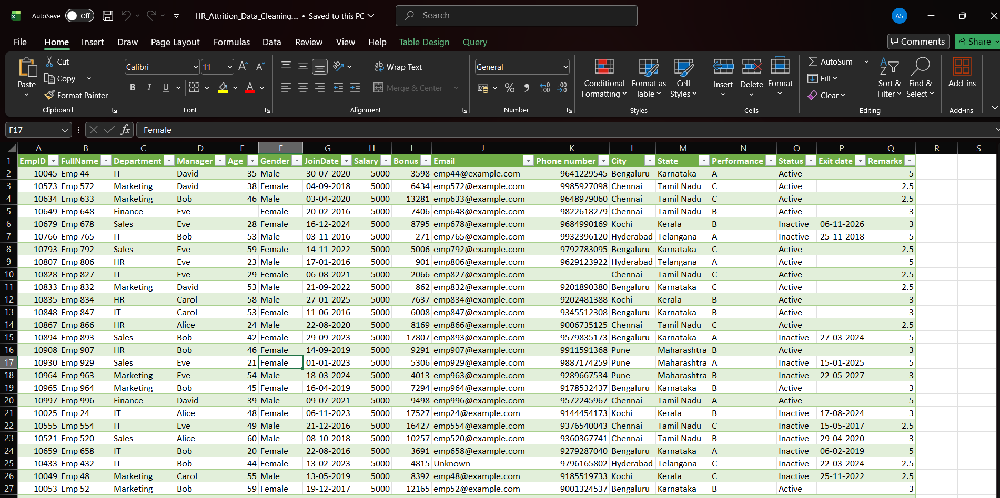
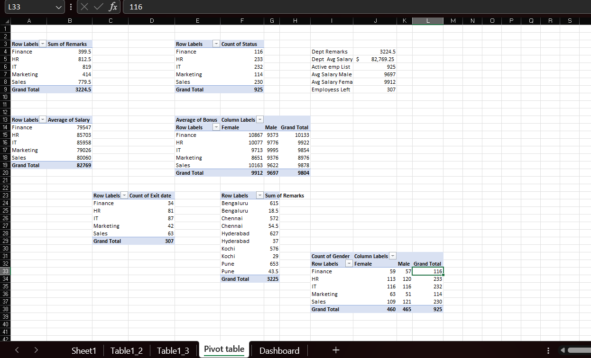
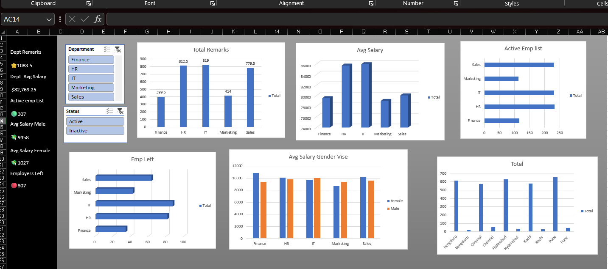

# HR Employee Attrition Analysis

## About the Project

This project focuses on analyzing employee attrition to understand employee turnover and identify patterns in workforce data. I used Excel to clean and organize the dataset, create pivot tables, and build an interactive dashboard to present key HR insights.

The goal of this project is to demonstrate how data analytics can help HR teams understand employee attrition and make data-driven decisions.

## Tools Used

- **Microsoft Excel** – Data cleaning and preparation
- **Pivot Tables** – Data summarization and analysis
- **Charts and Visualizations** – Identifying patterns and trends
- **Excel Dashboard** – Presenting key HR insights

## Project Workflow

1. **Raw Data:** Reviewed the original employee dataset.
2. **Data Cleaning:** Cleaned and prepared the data for analysis.
3. **Pivot Table Analysis:** Summarized employee data to explore attrition patterns.
4. **Dashboard Creation:** Created visualizations to present the analysis clearly.
5. **Insights:** Used the dashboard to explore employee attrition trends.

## Dataset

The dataset contains employee-related information used to explore workforce patterns and attrition.

**Dataset:** [Employee Attrition Dataset](Employee_Attrition_Dataset.csv)

## Project Screenshots

### 1. Raw Data
The original employee dataset before cleaning.

### 2. Cleaned Data
The dataset after cleaning and preparation.

### 3. Pivot Table Analysis
Pivot tables used to summarize and analyze employee data.

### 4. HR Attrition Dashboard
The dashboard presents key findings through charts and visualizations.

## Project Files

| File | Description |
|---|---|
| `Employee_Attrition_Dataset.csv` | Original employee dataset |
| `HR_Attrition_Data_Cleaning.xlsx.xlsx` | Excel workbook containing the analysis |
| `raw_data.png` | Screenshot of the original data |
| `cleaned_data.png` | Screenshot of the cleaned data |
| `pivot_table.png` | Screenshot of pivot table analysis |
| `dashboard.png` | Screenshot of the final dashboard |

**Excel Workbook:** [View Data Cleaning and Analysis Workbook](HR_Attrition_Data_Cleaning.xlsx.xlsx)

## Key Learnings

- Practiced cleaning and preparing employee data.
- Learned to summarize data using Excel Pivot Tables.
- Explored employee attrition patterns through data analysis.
- Developed a dashboard to communicate findings visually.
- Improved my understanding of how data analytics can support HR decision-making.

## Conclusion

This project helped me gain practical experience in Excel-based data cleaning, analysis, and dashboard development. It demonstrates how employee data can be transformed into meaningful insights to support HR teams in understanding attrition and workforce trends.

---

**Project Category:** Data Analytics | HR Analytics | Excel Dashboard
